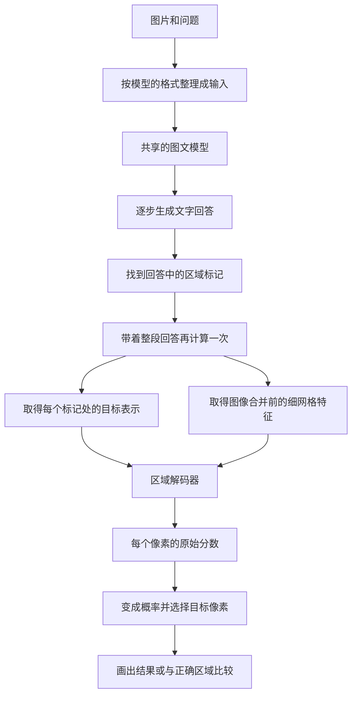

# 先认识整个过程

[返回上级](../README.md)

图片特征可以理解为“每个小位置的描述”，目标表示可以理解为“结合问题之后，当前要找什么”。模型把两者结合，才能得到每个位置是不是目标的分数。

特别注意：这里的区域是输出分支。代码没有把已经画出的区域裁下来，再送回语言模型重新看一遍。文字中的思考区域与最终答案区域也要区分。

自测：只看到 `<|mask|>` 这个文字标记，是否已经拿到一张区域图？**还没有，还要经过区域解码器。**

[下一节](02-inference.md)
